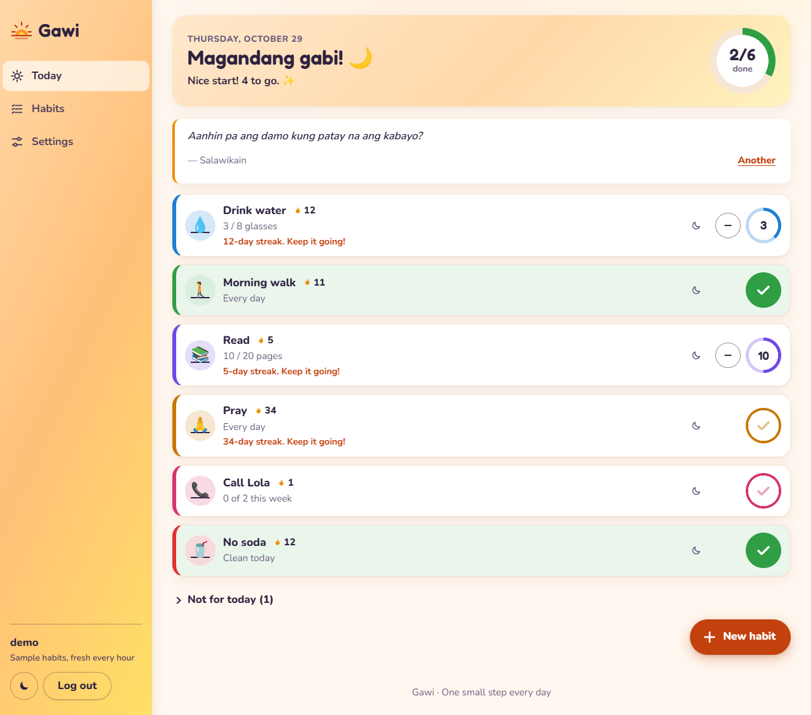
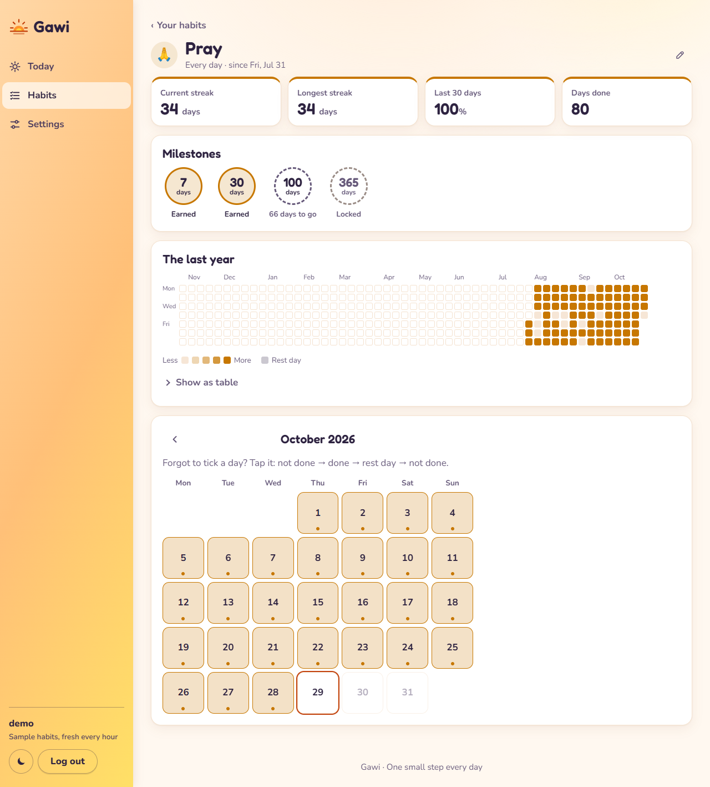
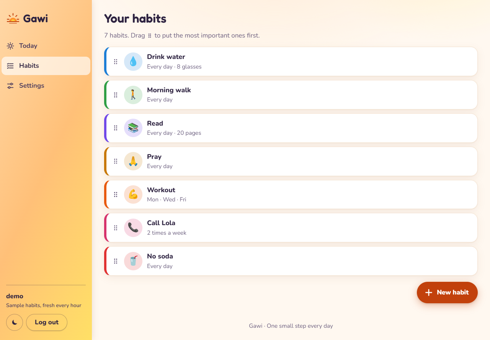
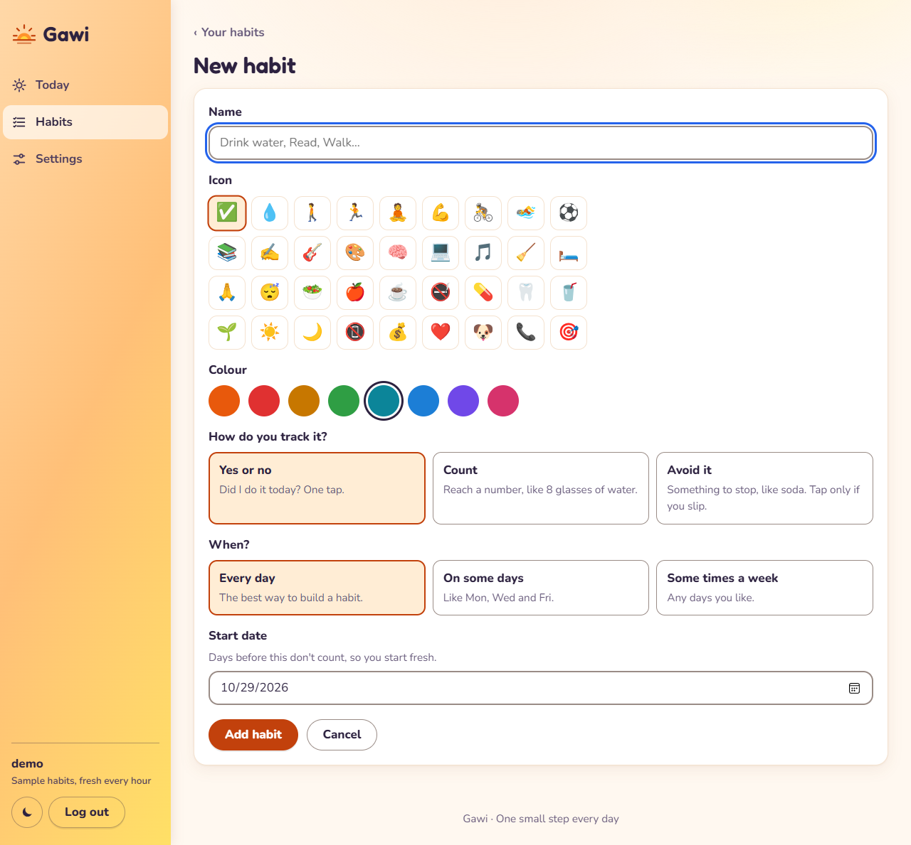
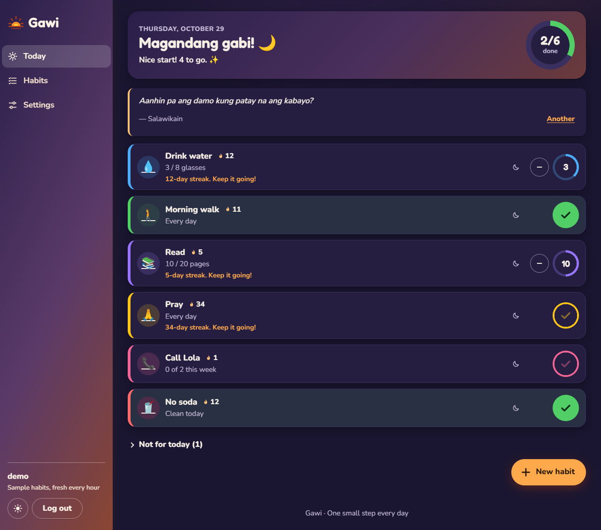
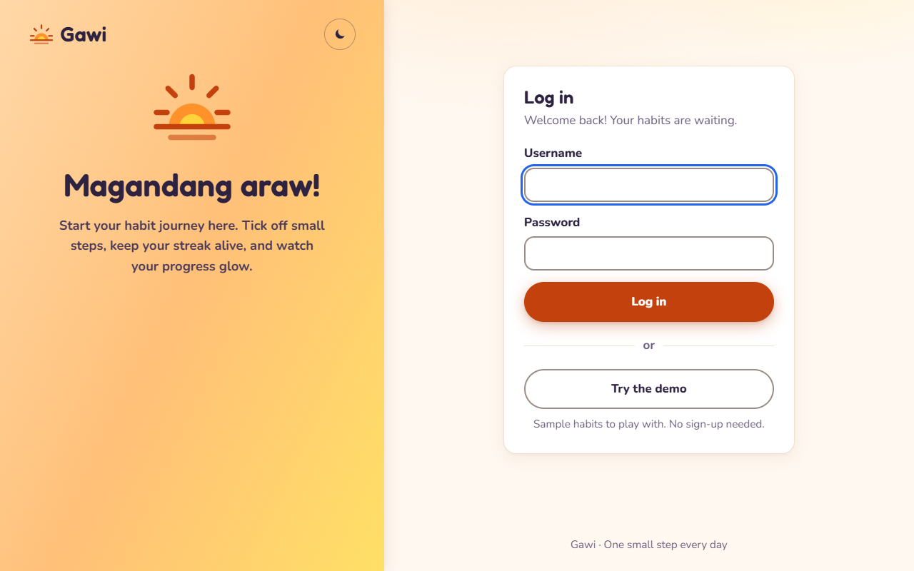
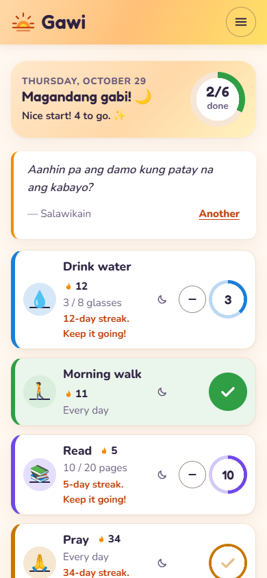
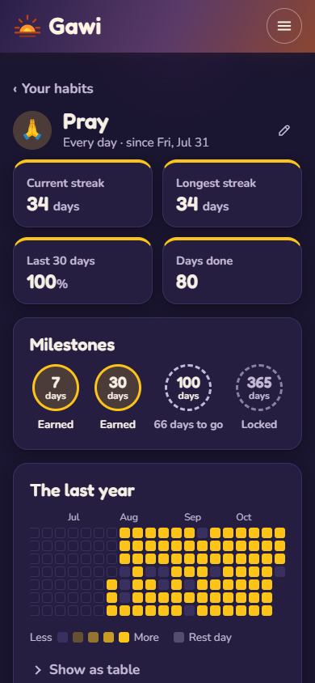

# Gawi ☀️

**Gawi** means "habit". This app helps you build good habits, one day at a time.

- Add your habits: "Drink water", "Read", "Walk"…
- A habit can be **yes or no** ("Did I pray today?") or a **count** ("8 glasses of water").
- A habit can be for **every day**, **some days** (Mon, Wed, Fri) or **some times a week**.
- A habit can also be one to **avoid** ("No soda"). Tap only if you slip.
- On the **Today** page, tap the big round button to tick a habit. The ring at the top shows how much of today is done.
- Each habit has a **streak** (days in a row). Sick or travelling? Tap the moon for a **rest day**. It does not break your streak.
- Get a **badge** at 7, 30, 100 and 365 days in a row.
- Tap a habit's name to see its page: your streaks, badges, a year of squares, and a calendar to fix days you forgot.
- Every day there is a new **quote** to cheer you on.
- Put Gawi on your **phone** like an app: see Settings.
- Drag the dots ⠿ on the Habits page to change the order.

The app is still being built. The plan is in [docs/PLAN.md](docs/PLAN.md).

## Screenshots

The pictures show the **demo** account, so all the habits are made up.

**Today.** Tap the big round button to tick a habit. The ring shows how much of today is done.



**A habit's page.** Your streaks, your badges, a year of squares, and a calendar to fix days you forgot.



**Your habits.** Drag the dots to change the order.



**A new habit.** Choose an icon, a colour, how you track it, and when.



**Dark mode.** Press the moon button to change it.



**Log in.** Or press "Try the demo".



**On a phone.** The menu is behind the ☰ button.

<p>
  
  
</p>

## How to run it

You need Python 3.13.

```
python -m venv .venv
.venv\Scripts\python -m pip install -r requirements.txt
.venv\Scripts\flask --app gawi init-db
.venv\Scripts\flask --app gawi create-user yourname
.venv\Scripts\flask --app gawi run --debug --port 5004
```

Then open http://127.0.0.1:5004 in your browser.
To look around first, press **Try the demo** on the login page.

## How to put it online

Gawi runs on **Render** (the website) and keeps its data in **Neon** (a free PostgreSQL database). Both have free plans.

1. In Neon, make a project (region: Singapore). Copy its **pooled** connection string (it starts with `postgresql://`).
2. On your computer, make the tables and your login in Neon:
   ```
   $env:DATABASE_URL = "postgresql://..."
   .venv\Scripts\flask --app gawi upgrade-db
   .venv\Scripts\flask --app gawi create-user yourname
   Remove-Item Env:DATABASE_URL
   ```
3. In Render, choose **New → Blueprint** and pick this repo. Render reads `render.yaml`. Paste the Neon string when it asks for `DATABASE_URL`.
4. Wait for "Live", then open the address Render shows (like `https://gawi.onrender.com`).

After that, every merge into `main` updates the site by itself.

## How to test it

```
.venv\Scripts\python -m pytest
```
